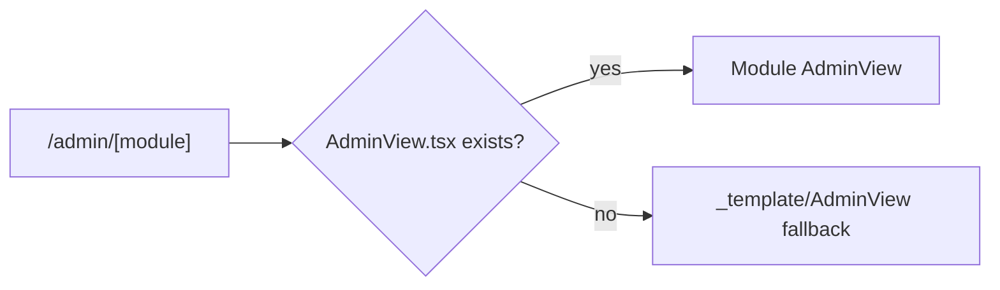

# Module Template (`_template`)

The best-practice reference module for LifeOS. `_template` contains a single `AdminView.tsx` that demonstrates the standard patterns every new admin module should follow: granular loading states, standardized error handling, accessibility attributes, search and filtering, and per-module settings integration.

This module is **not registered** in `src/registry.ts`. It is not reachable as `/admin/_template` and never renders a dashboard widget or public view.

## Overview

When the dynamic admin route (`src/app/admin/[module]/page.tsx`) tries to load an `AdminView` for a module slug, it falls back to `_template/AdminView` if the module folder has no `AdminView.tsx`. That means the template doubles as a graceful degradation layer: an unimplemented module still renders a working UI shell instead of crashing.



Because of this dual role, treat changes to `_template/AdminView.tsx` as API changes for every unimplemented module — keep it compiling and passing tests at all times.

## Data Schema

The template operates on `module_type: "template"` content with this payload shape (local `TemplateItem` interface in `AdminView.tsx`):

| Field         | Type      | Description                                       |
| ------------- | --------- | ------------------------------------------------- |
| `name`        | `string`  | **Required.** Display name; enforced on submit.   |
| `description` | `string`  | Optional detail text.                             |
| `category`    | `string`  | Category label, defaults to the settings default. |
| `is_active`   | `boolean` | Active flag, defaults to `true`.                  |

> **Important:** `template` is **not** registered in the `SchemaRegistry` (`src/lib/schemas.ts`), so `POST`/`PUT` requests with `module_type=template` are rejected by `/api/content` with `Unknown module_type` (400). `GET /api/content?module_type=template` still works. When scaffolding a real module from this template, register a `contentType` and Zod schema of your own — the template's `module_type` is for the demo surface and test mocks only.

## Module Settings

The template demonstrates `useModuleSettings("templateSettings", ...)` persisted in the global `system` config:

| Setting           | Default                           | Purpose                                |
| ----------------- | --------------------------------- | -------------------------------------- |
| `categories`      | `["General", "Work", "Personal"]` | Category list for form controls.       |
| `defaultCategory` | `"General"`                       | Category applied when the form resets. |

## Features

- **Granular loading states:** separate `loading` (list fetch), `isSubmitting` (create/update), and `isProcessingId` (per-row delete) flags, with `ContentListSkeleton` while the list loads.
- **Standardized error handling:** fetch errors surface through a `formError` banner in the form and inline alerts for deletes; failures never leave the UI stuck.
- **Accessibility:** explicit `htmlFor`/`id` pairs, `aria-label` on icon-only buttons (settings toggle, search, close form, delete item), and `disabled` states during submission.
- **Search & filtering:** client-side filter over `name` and `description`, memoized with `useMemo`.
- **Settings integration:** `useModuleSettings` hook wired with a `saving` indicator, demonstrating how real modules persist UI preferences.
- **Create/update flows:** a single form handles both modes via `editingId`, switching between `POST /api/content` and `PUT /api/content/[id]`.
- **Delete confirmation:** `confirm()` gate before `DELETE /api/content/[id]`.

## Components

- `AdminView.tsx`: The template admin interface (the only module file; no `Widget.tsx` or `PublicView.tsx`).
- `__tests__/AdminView.test.tsx`: Vitest coverage for empty state, search filtering, name validation, create success/failure, and delete confirmation/decline.

## Usage Example

**Scaffolding a new module from the template**

```bash
mkdir -p src/modules/my-module
cp src/modules/_template/AdminView.tsx src/modules/my-module/AdminView.tsx
```

Then in the copy:

1. Replace `module_type: "template"` with your module's `contentType`.
2. Register the module in `src/registry.ts` (slug, name, icon, `defaultPublic`, `contentType`, description, tags).
3. Add the payload Zod schema in `src/lib/schemas.ts` and register it in `SchemaRegistry`.
4. Update `TemplateItem` and `TemplateSettings` types to match your schema.
5. Add the icon to `IconMap` in `src/components/shell/AdminSidebar.tsx`.

**Querying template content (read-only, works today)**

```bash
curl "http://localhost:3091/api/content?module_type=template"
```

## Testing

```bash
NODE_ENV=test pnpm test -- src/modules/_template/__tests__/AdminView.test.tsx
```
